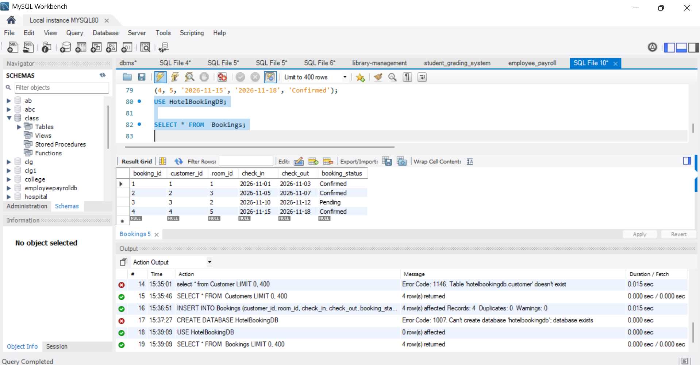
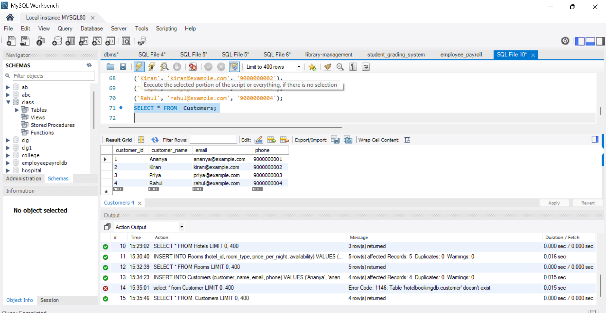
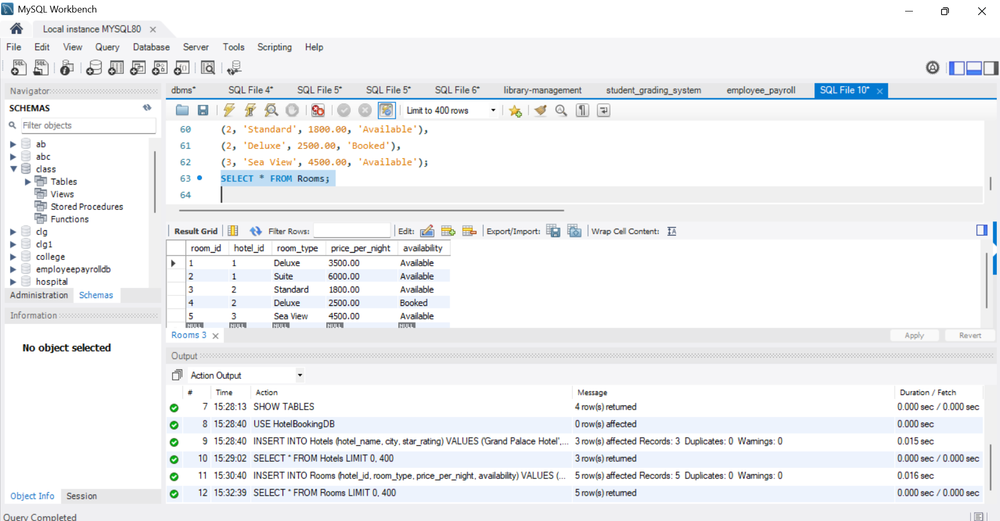
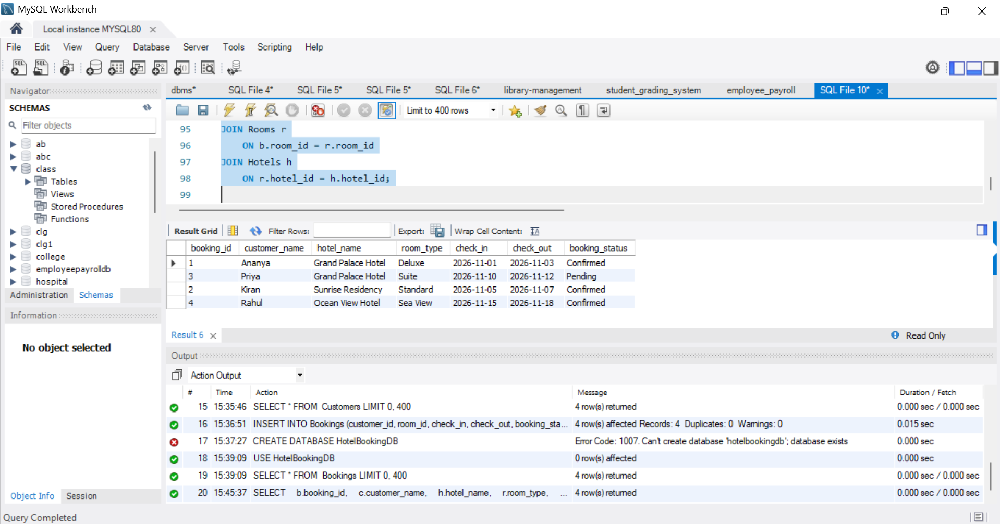
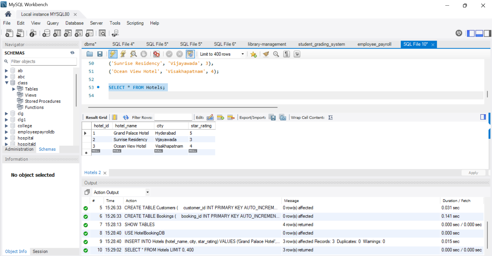
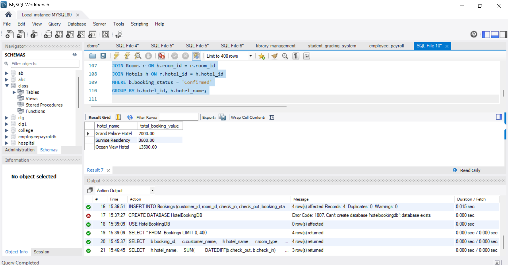

# Hotel Booking Database Management System

**Internship Details**

- **Internship Company:** CODTECH IT SOLUTIONS
- **Domain:** SQL
- **Intern Name:** Garnepudi Renuka Rani
- **Intern ID:** CITS8857
- **Project Title:** Hotel Booking Database Management System
- **Technologies Used:** MySQL, MySQL Workbench, SQL

---

## Project Overview
The Hotel Booking Database Management System is a SQL-based project designed to manage hotel details, room information, customer records, and hotel bookings. It uses MySQL to store and retrieve data efficiently and generate useful booking reports.

## Objectives
- Store and manage hotel information.
- Maintain room types, prices, and availability.
- Manage customer details.
- Record hotel reservations and booking status.
- Generate booking reports using SQL JOINs and aggregate functions.

## Technologies Used
- MySQL
- MySQL Workbench
- SQL

## Database Structure
The database contains four tables:

| Table Name | Description |
|---|---|
| Hotels | Stores hotel names, cities, and star ratings |
| Rooms | Stores room types, prices, and availability |
| Customers | Stores customer details |
| Bookings | Stores reservation dates and booking status |

## SQL Concepts Used
- CREATE DATABASE and CREATE TABLE
- INSERT INTO
- SELECT and WHERE
- Primary Keys and Foreign Keys
- INNER JOIN
- DATEDIFF()
- SUM() and GROUP BY

## Project Queries
1. Create the hotel booking database and tables.
2. Insert sample hotel, room, customer, and booking records.
3. Display all hotel and room details.
4. Retrieve booking information with customer and hotel names.
5. Calculate the total value of confirmed bookings for each hotel.

## Screenshots

### 1. Bookings Table

### 2. Customers Table

### 3. Rooms Table

### 4. Booking Report

### 5. Hotels Data

### 6. Revenue Report

## SQL File
[View hotel_data.sql](hotel_data.sql)
## How to Run
1. Install MySQL Workbench and connect to a MySQL server.
2. Open `hotel_booking.sql` in MySQL Workbench.
3. Execute the SQL statements in order.
4. Run the SELECT queries to view the results.

## Learning Outcomes
This project demonstrates relational database design, data manipulation, foreign key relationships, SQL joins, and basic booking revenue analysis.

## Author
**Garnepudi Renuka Rani**

## License
This project is created for educational and learning purposes.
